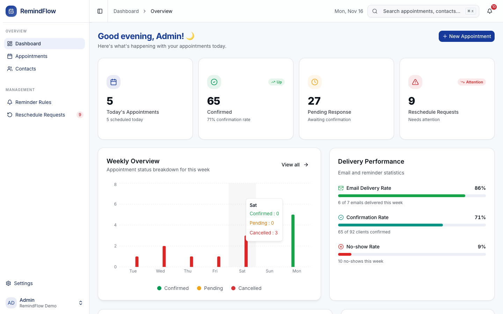

# Appointment Reminder Email System

A demo app that sends appointment reminder emails and lets clients confirm or ask to reschedule from the email.

<!-- Screenshot: add an image of the dashboard here -->
<!--  -->

## The problem

Small appointment-based businesses lose time and income when clients forget their appointments.
Staff often send reminders by hand and cannot see who confirmed.
This app plans the reminders, sends them by email, and shows staff the replies in one dashboard.

## Features

- Dashboard with reminder activity, delivery failures, no-shows and pending confirmations.
- Appointment list, appointment detail with a timeline, and a form to add an appointment.
- CSV import for appointments, with validation feedback for each row.
- Contacts: create, edit and soft delete.
- Reminder rules with custom email templates.
- Public confirm and reschedule pages that use expiring tokens.
- Reschedule inbox for staff.
- Email sending through Resend, and a Resend webhook endpoint that records delivery events.
- AI reschedule triage and AI reminder copy drafts with Google Gemini. These need a Gemini API key.
- Demo login screen. The credentials are fixed in the frontend and shown on the login page.

## Tech stack

- Next.js 16 (App Router) and React 19
- NestJS 11
- Prisma 7 with PostgreSQL
- Resend
- Google Gemini through `@google/genai`
- TanStack Query, Tailwind CSS 4, Radix UI
- Turborepo and pnpm

```text
apps/
  api/   NestJS API, Prisma schema, seed, Resend and Gemini code
  web/   Next.js dashboard and public confirm / reschedule pages
packages/
  ui, eslint-config, typescript-config
```

## Run locally

You need:

- Node.js 20.19 or later (set in `engines`; Prisma 7 supports 20.19+, 22.12+ and 24+)
- pnpm 9 (set in `packageManager`)
- A PostgreSQL database

1. Install from the repo root:

   ```bash
   pnpm install
   ```

2. Create the env files, then put your database URL in `apps/api/.env`:

   ```bash
   cp apps/api/.env.example apps/api/.env
   cp apps/web/.env.example apps/web/.env.local
   ```

3. Generate the Prisma client, create the tables and add demo data:

   ```bash
   pnpm --filter api run db:generate
   pnpm --filter api run db:push
   pnpm --filter api run db:seed
   ```

4. Start the API:

   ```bash
   cd apps/api
   pnpm build
   pnpm start
   ```

5. In a second terminal, start the web app:

   ```bash
   cd apps/web
   pnpm dev
   ```

Open `http://localhost:3000`. The app sends you to the login page, which shows the demo credentials.

### Environment variables

The values in the `.env.example` files are fake.

API (`apps/api/.env`):

| Variable                | Purpose                                                        |
| ----------------------- | -------------------------------------------------------------- |
| `DATABASE_URL`          | PostgreSQL connection URL                                      |
| `PORT`                  | Port the API listens on. `4000` in the example                 |
| `CORS_ORIGIN`           | URL of the web app                                             |
| `PUBLIC_WEB_URL`        | Base URL for the confirm and reschedule links in emails        |
| `INTERNAL_JOB_SECRET`   | Shared secret for the reminder dispatch endpoint               |
| `RESEND_API_KEY`        | Resend API key. Needed to send real email                      |
| `RESEND_FROM_EMAIL`     | Sender address                                                 |
| `RESEND_REPLY_TO`       | Reply-to address                                               |
| `RESEND_WEBHOOK_SECRET` | Optional. Verifies Resend webhooks                             |
| `GEMINI_API_KEY_1`      | Gemini API key. Needed for the AI features                     |
| `GEMINI_API_KEY_2`      | Optional second Gemini key                                     |
| `GEMINI_MODEL`          | Gemini model name                                              |

Web (`apps/web/.env.local`):

| Variable              | Purpose        |
| --------------------- | -------------- |
| `NEXT_PUBLIC_API_URL` | URL of the API |

### Other commands

From the repo root:

```bash
pnpm build         # build the API and the web app
pnpm check-types   # TypeScript check (run db:generate first)
```

## Deployment

The two apps deploy separately.

- Web: set the project root directory to `apps/web` and set `NEXT_PUBLIC_API_URL` to the API URL.
- API: set the root directory to `apps/api`. Build with `pnpm install && pnpm build`. Start with `pnpm start`. Set the API variables from the table above.

## Status and what's next

This is a portfolio demo. It is not a production system.

- The login is a demo gate in the frontend. There is no real user authentication.
- Due reminders are sent when the `POST /internal/jobs/dispatch-due-reminders` endpoint is called. No scheduler calls it yet.
- There are no automated tests.
- `pnpm lint` fails because `apps/web` has no ESLint config.
- The web build skips TypeScript errors (`ignoreBuildErrors` in `next.config.mjs`). A separate `tsc --noEmit` run on `apps/web` passes.

Next: add a scheduler for reminder dispatch, real authentication, tests and a working lint setup.

---

Built by [Adedamola](https://github.com/signordemola) · [Demola Studio](https://www.demolastudio.com)

See also: [booking-engine](https://github.com/signordemola/booking-engine)
